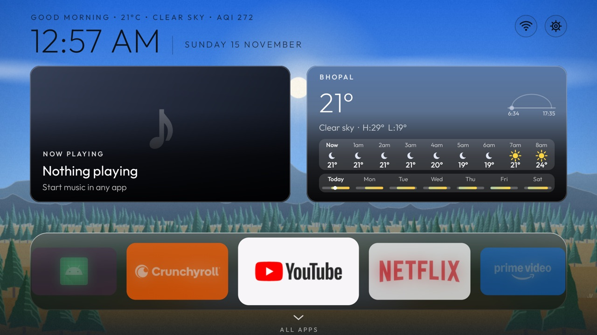
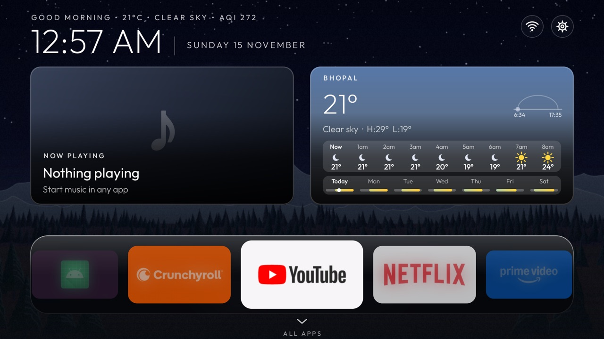
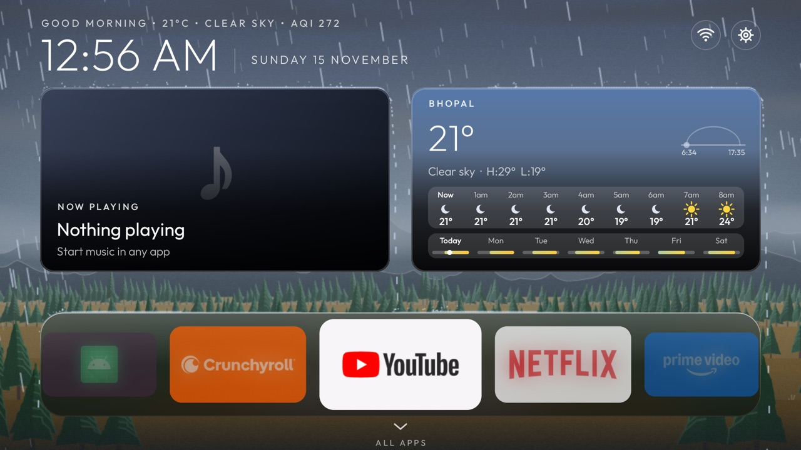
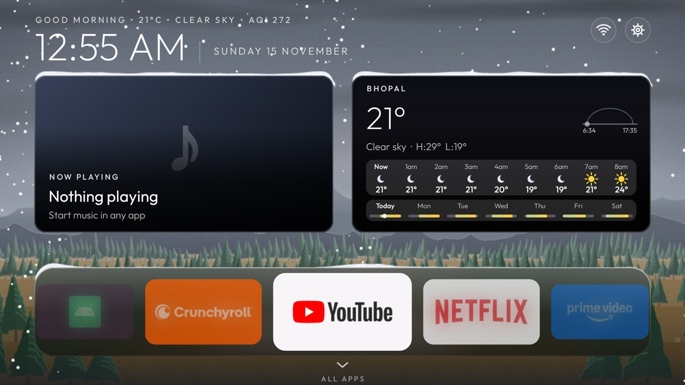
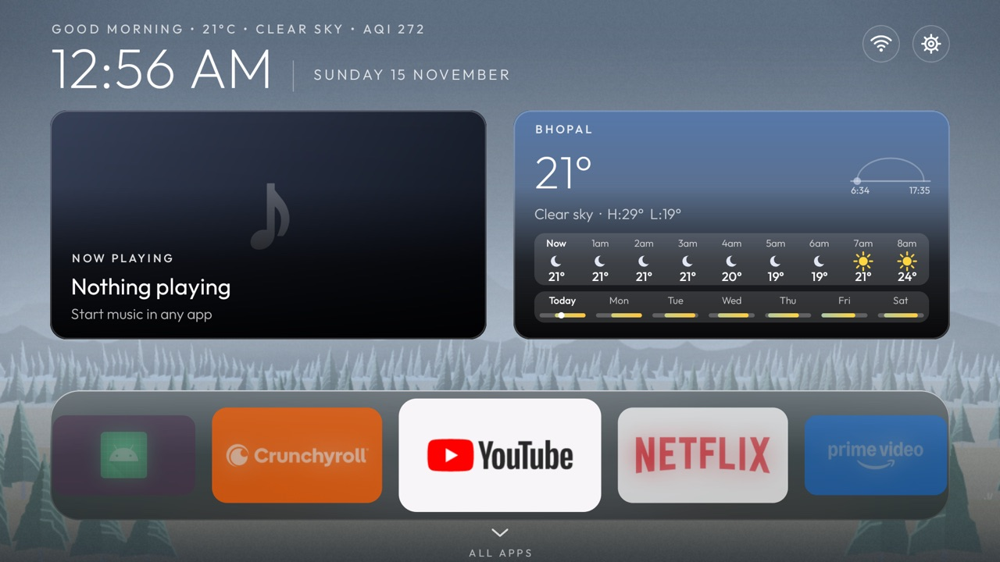
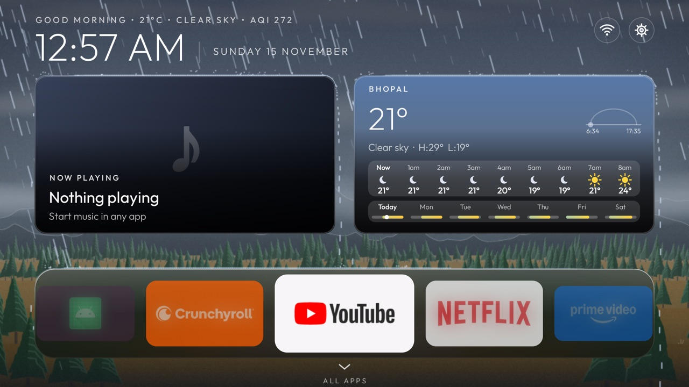

# Skyline (TV Launcher)

A tvOS-style home screen for Android TV, built for a TCL Google TV (Android 11, 1080p). Java and plain Views only,
minSdk 26 / targetSdk 33, Outfit font, no third-party libraries.

**Highlights:** looping app dock with depth of field, animated live sky that follows the real weather (rain, snow, fog,
storms, stars), frosted-glass dialogs, home cards (Wikipedia spotlight, news, now playing, weather, PlayStation),
clean mode, India AQI in the header, and a takeover of the Home button from Google TV.

| | |
|---|---|
|  |  |
|  |  |
|  |  |

## Install (no build needed)
1. Download `Skyline-0.1.apk` from the [latest release](https://github.com/bulletwa/skyline-tv-launcher/releases/latest).
2. On the TV enable Developer options and USB/network debugging, then:
   ```bash
   adb connect <tv-ip>:5555
   adb install Skyline-0.1.apk
   ```
   (Or sideload with any file manager / "Send Files to TV" app.)
3. Open **Skyline** once. To make it take over the Home button, enable its accessibility service
   (Settings → Accessibility → Skyline) and allow overlay permission. See [docs/FEATURES.md](docs/FEATURES.md).

The APK is a debug-signed build for Android TV, API 26+ (tested on Android 11).

## Build from source
```bash
cp local.properties.example local.properties   # set sdk.dir; waqi.token is optional
./gradlew testDebugUnitTest                    # unit tests
tools/deploy.sh 192.168.1.6:5555               # build + install over ADB + grants
```
Requires `openjdk@17` and Android SDK platform 33. Details in [docs/DEVELOPMENT.md](docs/DEVELOPMENT.md).

## Repository layout
```
app/src/main/java/com/tvlauncher/   launcher source (home, dock, sky, cards, settings, PlayStation)
app/src/main/{res,assets}           resources and the Outfit font
app/src/test/java/com/tvlauncher/   JVM unit tests
tools/                              deploy.sh, tv.sh (TV driver), scenarios, ink checks
docs/                               features, architecture, development, original build prompt
CLAUDE.md                           working notes and rules for AI-assisted development
```

## Documentation
See [docs/README.md](docs/README.md). Start with [FEATURES](docs/FEATURES.md) for behaviour and
[ARCHITECTURE](docs/ARCHITECTURE.md) for how it is built.

## Notes
- Needs the accessibility service bound to take over Home; `tools/deploy.sh` handles it.
- No API keys in source; the WAQI token lives in git-ignored `local.properties`.
